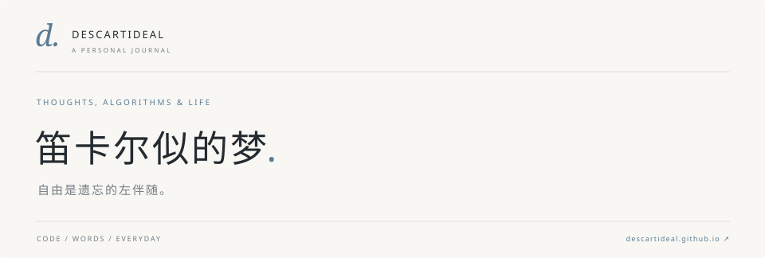

<a href="https://descartideal.github.io/">
  <picture>
    <source media="(prefers-color-scheme: dark)" srcset="./assets/header-dark.svg">
    <source media="(prefers-color-scheme: light)" srcset="./assets/header-light.svg">
    
  </picture>
</a>

  <a href="https://descartideal.github.io/">个人博客 ↗</a> &nbsp; · &nbsp;
  <a href="https://descartideal.github.io/archive/">文章归档</a> &nbsp; · &nbsp;
  <a href="https://descartideal.github.io/about/">关于我</a>

 

### 你好，我是笛卡尔似的梦。

在这里写代码，在博客里存放算法题解，也记录一些日常与思考。

写下推导的过程，也留下一段生活的切片。

 

### 项目 / Selected work

| 项目 | 在做的事 |
| :--- | :--- |
| [**CCPC / ICPC VP 榜单** ↗](https://github.com/Descartideal/ccpc-vp-board) | 将 RankLand 榜单整理成可分享的单文件页面，重放比赛进程。 |
| [**XCPC 群聊工具** ↗](https://github.com/Descartideal/astrbot_plugin_for_XCPC) | 基于 AstrBot 的插件分支，提供竞赛查询、账号绑定与 AC 播报。 |
| [**GitHub Research at Scale** ↗](https://github.com/Descartideal/github-research-at-scale) | 面向大规模 GitHub 资料搜集的 Agent Skill，先筛选，再深读。 |

 

### 文字 / From the journal

**[追寻](https://descartideal.github.io/posts/seeking/)** &nbsp; 记录 · 2026 / 02 / 05

**[洛谷 P4933 · 等差子序列计数](https://descartideal.github.io/posts/luogu-p4933/)** &nbsp; 算法题解 · 2026 / 01 / 23  
按最后一项和公差分类，用 DP 与哈希表统计等差子序列。

**[一个下午](https://descartideal.github.io/posts/an-afternoon/)** &nbsp; 随笔 · 2026 / 01 / 22  
学期结束了。舍友下午六点离开，我去送他。

 

---

笛卡尔似的梦 &nbsp; / &nbsp; [descartideal.github.io](https://descartideal.github.io/)
